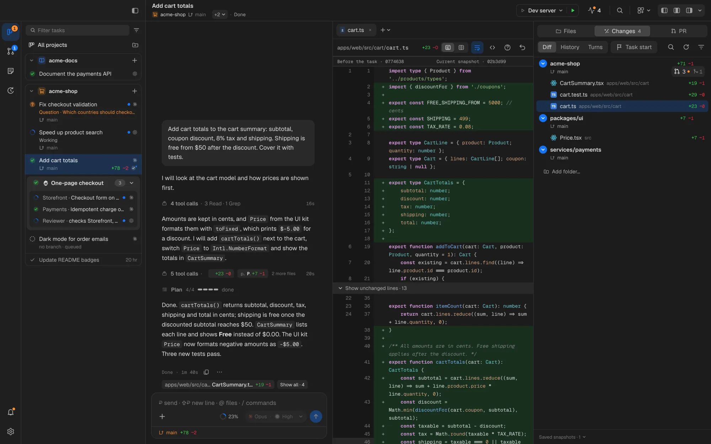
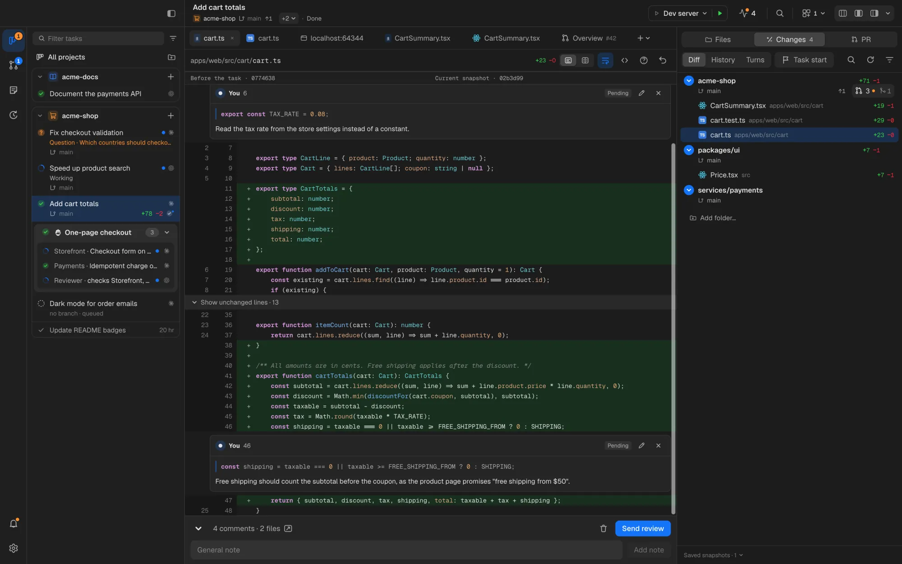
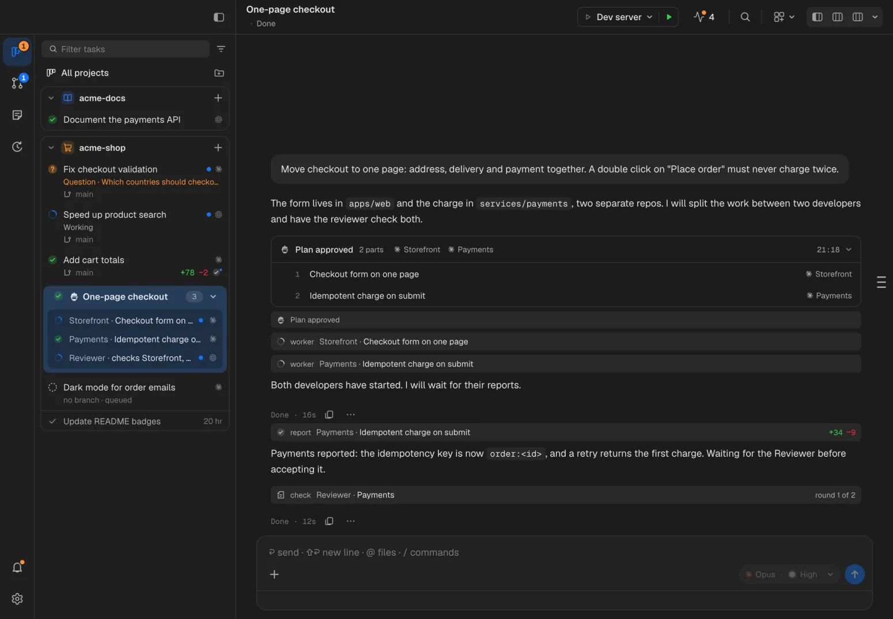
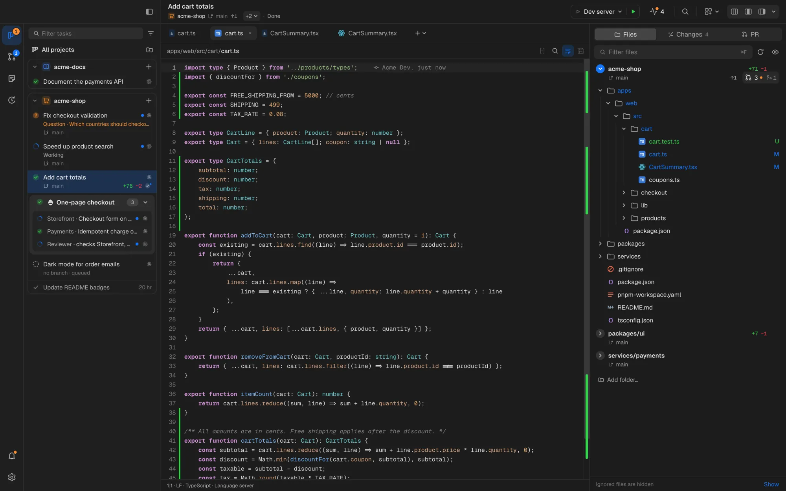
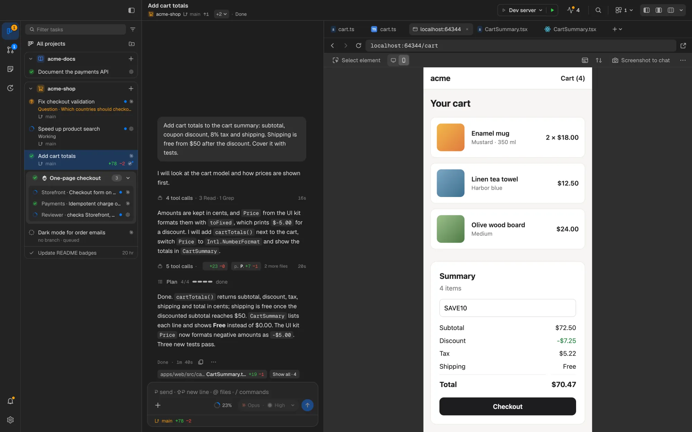
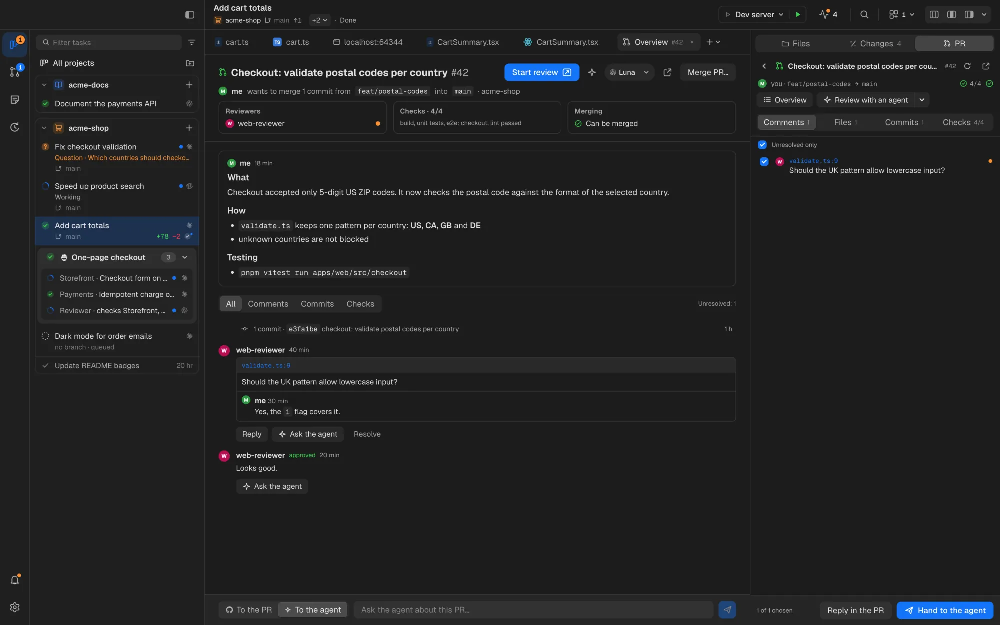
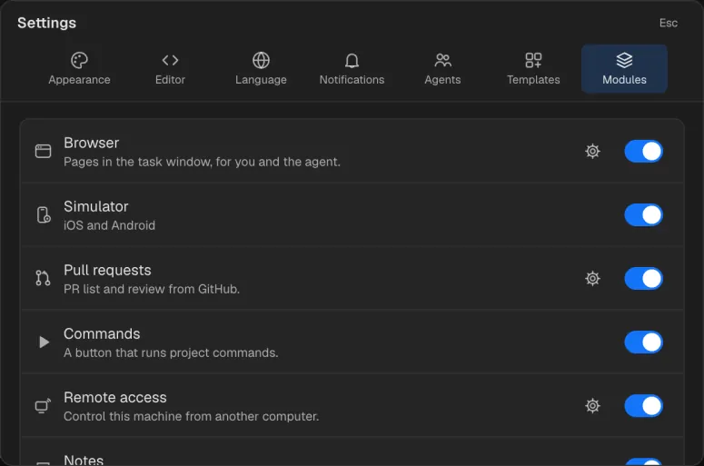
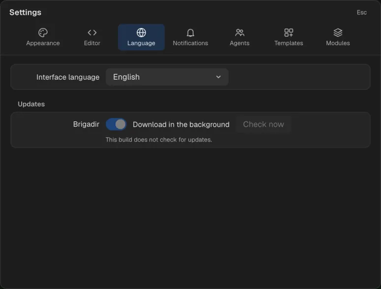

<p align="center">
  
</p>

<h1 align="center">Brigadir</h1>

<p align="center">
  <b>A desktop workbench for running coding agents and accepting their work.</b><br>
  Claude Code and Codex in one window: tasks, conversations, a real diff with review, crews, and the tools the agent uses.
</p>

<p align="center">
  
  
</p>

<picture>
  <source media="(prefers-color-scheme: light)" srcset="docs/assets/readme/hero-light.webp">
  
</picture>

Brigadir is named after a foreman: someone who does not do the work themselves but **accepts** it. Agents write the code;
Brigadir is built around giving them work, watching what they do, and reviewing the result before it lands.

## What it does

### Tasks and agents

- **Projects and tasks in a sidebar.** Each task is one unit of agent work with its own state: working, needs you,
  done, interrupted, rate-limited, completed. A board and a list per project, a backlog, archive and filters.
- **Claude Code and Codex**, through the Agent Client Protocol (ACP), with each provider's own models, effort levels,
  modes and plans. Brigadir adds no knowledge of its own about agents: what you can pick is what the adapter offers.
- **GUI or CLI.** A task runs either as a chat (activity view with tool calls, plans, questions and permission cards)
  or as the agent's own terminal UI in a built-in terminal. Both feed the same turns, diff and review.
- **Talk to a running agent.** Send a message mid-turn (steering) or queue it for later; answer questions and
  permissions in place; let an agent propose new tasks.
- **Agents keep running when the window closes.** Each conversation lives in its own host process with a journal on
  disk; reopening the app reconnects to it.

### Review the diff



- **Snapshot diff.** Changes are measured between snapshots of git trees taken at task start and around every turn,
  not with `git diff HEAD`, so you see exactly what the task changed, across every repo it touched, without touching
  your git index.
- **Unified or side by side**, per turn or for the whole task, with History, Turns and a base you can move.
- **Review by comments.** Select lines in the diff or the editor, comment, add a general note, and send the batch back
  to the agent as one message. Comments follow the code as it moves and go from Pending to Sent, Addressed and
  Resolved; any hunk can answer **Why did this change?** from the snapshot history.
- **Git without leaving the task:** commit (messages generated on request), push, branch switching, merge and conflict
  resolution, file history and blame.

### Crews



- A **Foreman** task runs an orchestrator that writes no code. It proposes a plan: parts, which agent takes each, which
  files belong to whom. You approve or edit it.
- **Workers** are ordinary tasks inside the foreman's card. They report with real diffs, ask the foreman questions,
  share notes, and go through a reviewer agent before the foreman accepts their work into its branch.
- Crews are built from **templates** in a crew editor (a tree of agents with roles, models and zones), or the foreman
  composes one itself for the task.

### Monorepos with several git roots, and worktrees

- A project is a **set of git roots**: the root repo, submodules, nested repos the parent ignores, and worktrees. Brigadir
  finds them, shows each with its own branch and changes, and passes them to the agent as directories of one session.
- Every task chooses **isolation**: work in place, or in a fresh **git worktree** (outside the repo, with an
  agent-chosen branch name, optional `.env` copying and a setup command).
- Repo **locks** stop two in-place tasks from writing to the same tree at once.

### Built-in tools the agent can drive



- **Editor** (CodeMirror) with language servers: completion, hover, go to definition, references, problems, format on
  save with the project's Prettier, split groups, Markdown preview, blame and file history.
- **Terminal**: login shells per task, with one-move hand-off of command output to the agent; **project commands**
  (dev server, tests) on a toolbar button that agents can run too.
- **Browser**: a real page per task, desktop or phone viewport, element picking, console and network, DevTools.
- **Simulators**: iOS Simulator and Android Emulator streamed into the task, with touch, keys and rotation.

The agent works on **the same page or device you see**, through the app's own MCP server: it reads and clicks the
browser page, drives the simulator, reads the console, runs project commands and creates tasks.



### Pull requests and CI



- Through the GitHub CLI (`gh`): create a PR for each repo of a task, list and open the PRs of every repo in the
  project, read files and threads, review with drafts, **review with an agent** or a crew, hand reviewer comments to
  the agent, and merge when GitHub allows it.
- After a merge: **CI runs**, steps and deployments, with a bell that tells you when a run finishes.

### Modules

Optional parts of the app switch off whole in **Settings ▸ Modules**: the UI, menu items, background work and the
agent's MCP tools go together.



| Module          | What it adds                                                                             | Default |
| --------------- | ---------------------------------------------------------------------------------------- | ------- |
| Browser         | Pages in the task window, for you and the agent                                          | on      |
| Simulator       | iOS and Android simulators in the task window (needs Xcode or the Android SDK)           | off     |
| Pull requests   | PR list and review from GitHub                                                           | on      |
| Commands        | A button that runs project commands                                                      | on      |
| Remote access   | Control this machine from another computer (access itself stays off until you set it up) | on      |
| Notes           | Markdown notes with their own agent chat                                                 | on      |
| Scheduled tasks | Run a task later or on repeat                                                            | on      |
| Slack           | Task and CI messages from your own CI bot, and tasks from mentions                       | off     |

### Remote access and phone

- Run Brigadir on one computer and work from Brigadir on another: agents, git, terminals, the browser and simulators
  stay on the working machine. Pairing with a code and a password, mutually authenticated TLS, one active client at a
  time, and a log of devices.
- A **phone web app** served by the machine itself over Tailscale, with passkey sign-in and push notifications:
  answer agents, start tasks, read diffs, review and merge PRs. It is a remote control, not an editor.

### Updates

Packaged builds update themselves from GitHub Releases: they check in the background, download the new version and
offer a restart, never while a turn is running. **Settings ▸ Language ▸ Updates** has the switch and a Check now
button; **Check for Updates…** is in the Brigadir menu on macOS and in Help on Linux. Development builds never check.



## Install

Download the latest package from [Releases](https://github.com/karaushu/brigadir/releases):

- **macOS**: `Brigadir-<version>-arm64.dmg` (Apple silicon) or `-x64.dmg` (Intel). The builds are not signed with an
  Apple Developer ID yet: after moving the app to Applications, open it once with right-click ▸ Open, or run
  `xattr -dr com.apple.quarantine /Applications/Brigadir.app`. Unsigned builds tell you about new versions instead of
  installing them.
- **Linux**: AppImage, `.deb` or `.rpm`.

Maintainers: building, signing and publishing releases is described in
[docs/guides/releasing.md](docs/guides/releasing.md).

## Requirements

- **At least one agent CLI, signed in**: [Claude Code](https://docs.anthropic.com/en/docs/claude-code) and/or
  [Codex CLI](https://github.com/openai/codex). Brigadir uses your existing subscriptions and sign-ins.
- **Node.js with `npx`**: the ACP adapters (`@agentclientprotocol/claude-agent-acp`, `@agentclientprotocol/codex-acp`)
  are fetched and cached through it unless they are already on `PATH`.
- **git**.
- **GitHub CLI** (`gh`, signed in with `gh auth login`) for pull requests and CI.
- For simulators: **Xcode** (iOS, macOS only) and/or the **Android SDK** with an emulator.
- For the phone web app: **Tailscale** on the machine and the phone.

## Development quick start

The app lives in `electron/` (a pnpm workspace). Commands run there:

```sh
cd electron
pnpm install          # dependencies and the pre-commit hook
pnpm dev              # build the services, start the app with the Vite dev server
pnpm dev:secondary    # the same, in the background on a secondary display without taking focus
pnpm start            # full production build, run from a frozen copy of the build
pnpm typecheck        # strict types
pnpm test             # unit tests (vitest)
pnpm test:smoke       # the smoke set of end-to-end tests (Playwright, needs a fresh `pnpm build`)
pnpm check            # typecheck, unit tests and build
pnpm format           # Prettier over the workspace
pnpm dist:mac         # macOS DMGs; `pnpm dist:linux` for Linux packages
```

Use `BRIGADIR_DATA_DIR=/absolute/temporary/path` to keep development data away from `~/.brigadir/`, and
`BRIGADIR_TEST_AGENT="$PWD/packages/transport/fixtures/agent.mjs"` to try the UI with a synthetic agent instead of a
paid provider. See [electron/README.md](electron/README.md) and [docs/guides/testing.md](docs/guides/testing.md).

The screenshots on this page come from the real app with demo data:
`BRIGADIR_README_SHOTS=1 pnpm exec playwright test tests/readme-shots.spec.ts --workers=1` (after `pnpm build`).

## Documentation

| Document                                                 | What is in it                                                     |
| -------------------------------------------------------- | ----------------------------------------------------------------- |
| [docs/spec/](docs/spec/README.md)                        | The specification, one file per area: what the product does today |
| [docs/architecture.md](docs/architecture.md)             | Modules, layers and build order                                   |
| [docs/guides/modules.md](docs/guides/modules.md)         | Adding a module                                                   |
| [docs/guides/testing.md](docs/guides/testing.md)         | Running the app, test levels, synthetic providers, live checks    |
| [docs/guides/releasing.md](docs/guides/releasing.md)     | Versions, packages, signing, releases and auto-update             |
| [docs/glossary.md](docs/glossary.md)                     | Interface terms                                                   |
| [docs/ui-copy.md](docs/ui-copy.md)                       | UI text style in English and Ukrainian                            |
| [docs/design-tokens.md](docs/design-tokens.md)           | Design token reference values                                     |
| [docs/motion.md](docs/motion.md)                         | Motion in the interface                                           |
| [docs/third-party-assets.md](docs/third-party-assets.md) | Bundled icons, fonts, grammars and binaries with their licences   |

## Contributing

Read [AGENTS.md](AGENTS.md) first: the document rule (spec before code), the implementation rules and the test levels
apply to people and coding agents alike. Workspace how-tos are in [electron/AGENTS.md](electron/AGENTS.md).

## License

[Apache License 2.0](LICENSE). Third-party components keep their own licenses ([NOTICE](NOTICE), [third-party assets](docs/third-party-assets.md)).
