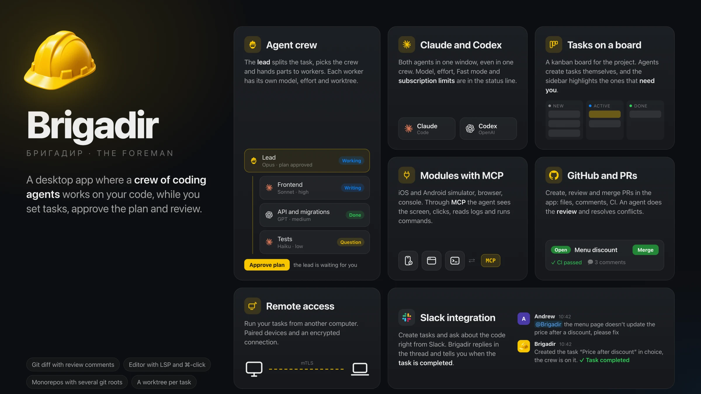

<p align="center">
  
</p>

<h1 align="center">Brigadir</h1>

<p align="center">
  <b>Run coding agents and review their changes.</b><br>
  Claude Code and Codex with tasks, chat, diff review and built-in tools.
</p>

<p align="center">
  
  
</p>



<picture>
  <source media="(prefers-color-scheme: light)" srcset="docs/assets/readme/hero-light.webp">
  
</picture>

Brigadir means “foreman.” Assign tasks to agents and review their changes.

## What it does

### Tasks and agents

- **Tasks.** Organize projects and tasks in a sidebar, board or list. Track status, filter tasks and manage the backlog
  and archive.
- **Claude Code and Codex.** Available models, effort levels and modes come from each provider’s Agent Client Protocol
  (ACP) adapter.
- **GUI or CLI.** Use chat with tool calls, plans, questions and permission requests, or the agent’s terminal UI.
  Both support turns, diff and review.
- **Messages.** Send messages mid-turn (steering) or queue them. Answer questions, approve permissions and review
  tasks proposed by agents.
- **Background work.** Agents keep running after you close the window. Reopen Brigadir to reconnect.

### Review the diff


- **Snapshot diff.** Compare git tree snapshots from task start or individual turns across repos. The diff leaves your
  git index unchanged.
- **Unified or side by side**, per turn or for the whole task, with file history and a selectable base.
- **Review by comments.** Comment on code or add a general note, then send the comments to the agent together. Track comments
  from Pending through Sent, Addressed and Resolved. **Why did this change?** shows a hunk’s snapshot history.
- **Git:** commit (messages generated on request), push, branch switching, merge and conflict
  resolution, file history and blame.

### Crews


- A **Foreman** task runs an orchestrator that writes no code. It proposes a plan: parts, which agent takes each, which
  files belong to whom. You approve or edit it.
- **Workers** are ordinary tasks inside the foreman's card. They report with diffs, ask the foreman questions,
  share notes, and go through a reviewer agent before the foreman accepts their work into its branch.
- Crews are built from **templates** in a crew editor (a tree of agents with roles, models and zones), or the foreman
  composes one itself for the task.

### Monorepos and worktrees

- A project is a **set of git roots**: the root repo, submodules, nested repos the parent ignores, and worktrees. Brigadir
  finds them, shows each with its own branch and changes, and passes them to the agent as directories of one session.
- Every task chooses **isolation**: work in place, or in a fresh **git worktree** (outside the repo, with an
  agent-chosen branch name, optional `.env` copying and a setup command).
- Repo **locks** stop two in-place tasks from writing to the same tree at once.

### Built-in tools


- **Editor** (CodeMirror) with language servers: completion, hover, go to definition, references, problems, format on
  save with the project's Prettier, split groups, Markdown preview, blame and file history.
- **Terminal**: login shells per task. Send command output to the agent. Run **project commands**, such as a dev server
  or tests, from the toolbar or through the agent.
- **Browser**: a browser per task, desktop or phone viewport, element picking, console and network, DevTools.
- **Simulators**: iOS Simulator and Android Emulator streamed into the task, with touch, keys and rotation.

Through Brigadir’s MCP server, agents use the same browser and simulator as you. They can also read console output,
run project commands and create tasks.


### Pull requests and CI


Uses the GitHub CLI (`gh`).

- **Create PRs** for each repo and browse all PRs in a project.
- **Review** files and threads, draft comments, or request a review from an agent or crew.
- **Fix and merge.** Send review comments to the agent. Merge when GitHub allows it.
- **CI.** View runs, steps and deployments after a merge. Get notified when a run finishes.

### Modules

Disable modules in **Settings ▸ Modules** to remove their UI, menu items, background work and agent tools.


| Module          | What it adds                                                                             | Default |
| --------------- | ---------------------------------------------------------------------------------------- | ------- |
| Browser         | Pages in the task window, for you and the agent                                          | on      |
| Simulator       | iOS and Android simulators in the task window (needs Xcode or the Android SDK)           | off     |
| Pull requests   | PR list and review from GitHub                                                           | on      |
| Commands        | Run project commands                                                                     | on      |
| Remote access   | Control this machine from another computer (access itself stays off until you set it up) | on      |
| Notes           | Markdown notes with their own agent chat                                                 | on      |
| Scheduled tasks | Run a task later or on repeat                                                            | on      |
| Slack           | Task and CI messages from your own CI bot, and tasks from mentions                       | off     |

### Remote access and phone

- Run Brigadir on one computer and work from Brigadir on another: agents, git, terminals, the browser and simulators
  stay on the working machine. Pairing with a code and a password, mutually authenticated TLS, one active client at a
  time, and a log of devices.
- A **phone web app** served by the machine itself over Tailscale, with passkey sign-in and push notifications:
  answer agents, start tasks, read diffs, review and merge PRs. It is a remote control, not an editor.

### Updates

Packaged builds check GitHub Releases for updates.

- **Developer ID macOS builds and AppImage** can download updates in the background and install them on restart or
  quit. Installation waits until active agent turns finish.
- **Ad-hoc macOS builds, `.deb` and `.rpm`** notify you and open the release page for manual installation.
- **Development builds** do not check for updates.

Manage updates in **Settings ▸ Language ▸ Updates**. **Check for Updates…** is also in the Brigadir menu on macOS
and Help on Linux.


## Install

Download the latest package from [Releases](https://github.com/karaushu/brigadir/releases):

- **macOS**: `Brigadir-<version>-arm64.dmg` (Apple silicon) or `-x64.dmg` (Intel). The builds are not signed with an
  Apple Developer ID yet: after moving the app to Applications, open it once with right-click ▸ Open, or run
  `xattr -dr com.apple.quarantine /Applications/Brigadir.app`. Unsigned builds tell you about new versions instead of
  installing them.
- **Linux**: AppImage, `.deb` or `.rpm`.

Maintainers: building, signing and publishing releases is described in
[docs/guides/releasing.md](docs/guides/releasing.md).

## Requirements

- **At least one agent CLI, signed in**: [Claude Code](https://docs.anthropic.com/en/docs/claude-code) and/or
  [Codex CLI](https://github.com/openai/codex). Brigadir uses your existing subscriptions and sign-ins.
- **Node.js with `npx`**: the ACP adapters (`@agentclientprotocol/claude-agent-acp`, `@agentclientprotocol/codex-acp`)
  are fetched and cached through it unless they are already on `PATH`.
- **git**.
- **GitHub CLI** (`gh`, signed in with `gh auth login`) for pull requests and CI.
- For simulators: **Xcode** (iOS, macOS only) and/or the **Android SDK** with an emulator.
- For the phone web app: **Tailscale** on the machine and the phone.

## Development quick start

Install dependencies and start the app:

```sh
cd electron
pnpm install
pnpm dev
```

For build, test and packaging commands, see [electron/README.md](electron/README.md),
[testing](docs/guides/testing.md) and [releasing](docs/guides/releasing.md).

Use `BRIGADIR_DATA_DIR=/absolute/temporary/path` to keep development data away from `~/.brigadir/`, and
`BRIGADIR_TEST_AGENT="$PWD/packages/transport/fixtures/agent.mjs"` to try the UI with a synthetic agent instead of a
paid provider. See [electron/README.md](electron/README.md) and [docs/guides/testing.md](docs/guides/testing.md).

The screenshots on this page come from the real app with demo data:
`BRIGADIR_README_SHOTS=1 pnpm exec playwright test tests/readme-shots.spec.ts --workers=1` (after `pnpm build`).

## Documentation

| Document                                                 | What is in it                                                     |
| -------------------------------------------------------- | ----------------------------------------------------------------- |
| [docs/spec/](docs/spec/README.md)                        | The specification, one file per area: what the product does today |
| [docs/architecture.md](docs/architecture.md)             | Modules, layers and build order                                   |
| [docs/guides/modules.md](docs/guides/modules.md)         | Adding a module                                                   |
| [docs/guides/testing.md](docs/guides/testing.md)         | Running the app, test levels, synthetic providers, live checks    |
| [docs/guides/releasing.md](docs/guides/releasing.md)     | Versions, packages, signing, releases and auto-update             |
| [docs/glossary.md](docs/glossary.md)                     | Interface terms                                                   |
| [docs/ui-copy.md](docs/ui-copy.md)                       | UI text style in English and Ukrainian                            |
| [docs/design-tokens.md](docs/design-tokens.md)           | Design token reference values                                     |
| [docs/motion.md](docs/motion.md)                         | Motion in the interface                                           |
| [docs/third-party-assets.md](docs/third-party-assets.md) | Bundled icons, fonts, grammars and binaries with their licences   |

## Contributing

Read [AGENTS.md](AGENTS.md) first: the document rule (spec before code), the implementation rules and the test levels
apply to people and coding agents alike. Workspace how-tos are in [electron/AGENTS.md](electron/AGENTS.md).

## License

[Apache License 2.0](LICENSE). Third-party components keep their own licenses ([NOTICE](NOTICE), [third-party assets](docs/third-party-assets.md)).
