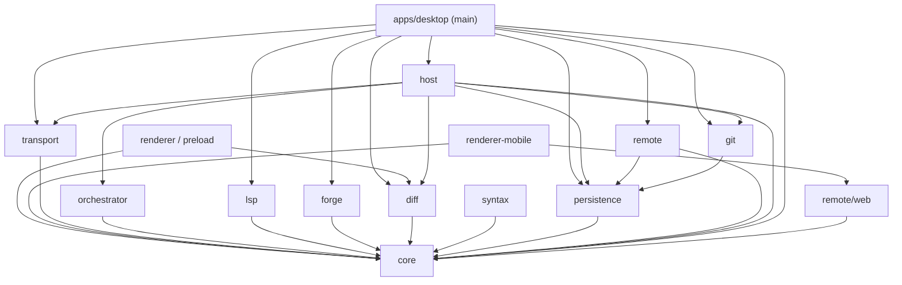

# Architecture

How the Brigadir code is split into processes and packages, which way dependencies point, and where new code goes.
Behaviour lives in the [spec](spec/README.md); this file is about structure. All code paths are relative to
`electron/`.

## Processes

| Process | Code | Started by | Lifetime |
| --- | --- | --- | --- |
| Electron main | `apps/desktop/src/main` | the person | app session; owns the window, menus, IPC handlers, stores of UI state, host clients, remote gateway |
| Preload | `apps/desktop/src/preload` | main, per window | sandboxed; exposes `window.brigadir`, built from the channel table |
| Renderer | `apps/desktop/src/renderer` | main | one per window; React 19 + `zustand`, CSS Modules over `tokens.css`; `sandbox: true`, `contextIsolation: true` |
| Mobile renderer | `apps/desktop/src/renderer-mobile` | a phone's browser | web client served by main's web listener (`packages/remote`) |
| Task host | `packages/host` → `out/services/host.cjs` | main (`spawn(process.execPath, …, {detached: true})`, `ELECTRON_RUN_AS_NODE=1`); a crew host spawns its worker hosts the same way | one per task; survives window close, quit and crash of the app |
| Agent adapter / CLI | `packages/transport` (ACP), `packages/host` (PTY) | the host | while the host runs a session |
| Worker threads | `diff.cjs`, `syntax.cjs` | main (`main/worker.ts` pool) | pooled, exit after 30 s idle |
| Node services | `prettier.cjs`, `android.cjs`, bundled TypeScript language server | main, on `process.execPath` | on demand |
| Native helpers | see [Natives](#natives) | main, the host or the agent | per call or per device/session |

The host is a plain detached child, not a `utilityProcess`: it must run without Electron (tests) and must outlive the
app. Main also runs short ACP sessions itself (`oneShotText`, quick questions, note chats, agent catalog reads) through
`packages/transport`; those never touch a task journal.

Details: [processes](spec/architecture-and-platform.md#processes),
[session host](spec/architecture-and-platform.md#session-host),
[socket protocol](spec/architecture-and-platform.md#socket-protocol),
[MCP served by the host](spec/architecture-and-platform.md#mcp-relay),
[PTY and hooks](spec/architecture-and-platform.md#pty-and-hooks).

## Workspace packages

pnpm workspace `electron/pnpm-workspace.yaml`: `apps/*` and `packages/*`. Packages export TypeScript sources
(`"exports": "./src/index.ts"`); there is no per-package build, the bundlers consume the sources.

| Package | Depends on | Role | Runs in |
| --- | --- | --- | --- |
| `@brigadir/core` | — | domain types and validators (`AgentEvent`, `SessionEvent`, tasks, scopes, review, crew), message catalog, keymap, menus, IPC channel table. No Node, no DOM: `packages/core/tsconfig.json` sets `lib: ES2023`, `types: []` | everywhere |
| `@brigadir/persistence` | core | data root, `jsonText`, `atomicJson`, JSONL journal (`SessionStore`), attachments, notes, schedules, templates, `process-owner` helper source | main, host, git, remote |
| `@brigadir/diff` | core | line diff, hunks, side-by-side pairs, word spans, anchors, 3-way merge; `worker.ts` entry | main, worker, renderer (pure functions) |
| `@brigadir/syntax` | core | `web-tree-sitter` with pinned WASM grammars, tokens and symbol paths; `worker.ts` entry | worker only |
| `@brigadir/forge` | core | `gh` CLI: pull requests, CI runs | main |
| `@brigadir/lsp` | core, `typescript-language-server` | LSP client, server pool, document mirror, Prettier pool | main |
| `@brigadir/orchestrator` | core | crew briefs, tool sets per role, plan parsing, reports | host |
| `@brigadir/transport` | core, `@agentclientprotocol/sdk` | ACP client, adapter launch, ACP → domain mapping (`mapper.ts`), catalog, quota/usage readers, one-shot sessions; `./cli-hooks` | host, main |
| `@brigadir/git` | core, persistence | git CLI, scope discovery, snapshot trees and refs, worktrees, history, merge, branch switch | host, main |
| `@brigadir/remote` | core, persistence, `ws`, `@noble/*`, `bonjour-service` | remote-access identity, pairing (CPace), mTLS gateway, web gateway, mDNS; `./web` is Node-free for the phone bundle | main, mobile renderer (`./web`) |
| `@brigadir/host` | core, diff, git, orchestrator, persistence, transport, `node-pty`, `@xterm/headless`, `zod` | task host server (`entry.ts`), terminals, MCP server, crew host, hook entry; `./client` is the socket client main uses | host process; main imports `./client`, `./login-shell`, `./mcp-list` only |
| `@brigadir/desktop` (`apps/desktop`) | core, diff, forge, git, host, lsp, persistence, remote, transport | Electron app: main, preload, renderer, mobile renderer, services entry points, natives | — |

### Dependency graph

Arrows point from a package to what it imports (checked against `package.json` and `@brigadir/*` imports in `src`).



`syntax` has no package consumer: `build-services.mjs` bundles its worker into `syntax.cjs`, and main talks to it by
message.

## Layer rule

Dependencies point only downward, and a feature never depends on another feature.

- **Tiers.** `core` → leaf packages (`persistence`, `diff`, `syntax`, `forge`, `lsp`, `orchestrator`, `transport`) →
  `git`, `remote` → `host` → `apps/desktop`. Packages on the same tier do not import each other.
- **Renderer sees `core` only** (plus the pure `diff` functions), and reaches main only through `window.brigadir`.
  Mobile renderer: `core`, `remote/web` and DOM-free helpers or `ui/` controls of the desktop renderer.
- **Main** depends on the host through `@brigadir/host/client` only; it never loads the PTY or agent code of the host.
- **Inside the renderer**, screens (`App`, `TaskView`, `ProjectScreen`) compose surface components top-down. What two
  surfaces share goes into `renderer/ui/` (one look, one component) or a DOM-free module; feature CSS only places
  things. See [one look, one component](spec/appearance.md#one-look-one-component).
- **Inside main**, `main/index.ts` is the composition root: it creates the stores and services, wires them together
  and registers the IPC handlers.

See also [layer rules](spec/architecture-and-platform.md#layer-rules).

## IPC boundary

- **One table.** `packages/core/src/ipc-channels.ts` has one row per `DesktopBridge` method: `kind` (`invoke`,
  `subscribe`, `local`), channel, class (`remote` runs on the working machine, `client` on the machine that shows the
  window), optional `remote: 'forbidden' | 'guarded'`, and for invokes the runtime validator. `ipcTableHash()` is
  part of the remote handshake.
- **Preload** calls `createDesktopBridge` with a transport; the renderer gets named methods only. The generic
  `invoke(channel, args)` never leaves the preload. One `ipcRenderer` listener per channel fans out to subscribers.
- **Main** registers each handler with `register(channel, run)`; every call goes through `main/dispatch.ts`
  (`dispatchCall`): validator → forwarding for a window of another machine → device rules → active client → handler.
  `main/clients.ts` decides which clients receive an event; `main/trusted-sender.ts` checks the sender frame and URL.
- **No paths or commands from the renderer.** Files cross as opaque IDs that main resolves; launch commands are chosen
  by main.
- **Main ↔ host**: newline-delimited JSON-RPC (`Peer`) over a Unix socket with per-role tokens (`ui`, `mcp`, `hook`,
  `crew`). Its vocabulary is domain types only, the same as the journal.

Details: [IPC boundary](spec/architecture-and-platform.md#ipc-boundary),
[remote call boundary](spec/remote-access-and-mobile.md#call-boundary).

## Domain model seam

```
agent (ACP stdio) ──► transport/mapper.ts ──► AgentEvent ──► host ──► SessionEvent ──► events.jsonl
                                                                  └──► socket ──► main ──► IPC ──► renderer
renderer ──► SessionCommand ──► main ──► host ──► AgentCommand ──► transport ──► ACP request
```

- `AgentEvent` / `AgentCommand` (`core/agent.ts`) are what a transport produces and accepts.
- `SessionEvent` / `SessionCommand` (`core/session.ts`) extend them with host records (`prompt.queued`,
  `checkpoint.created`, `host.stopped`, …) and host commands (`answerPermission`, `submitReview`, `decidePlan`, …).
  Journal record: `{schemaVersion: 1, seq, at, event: SessionEvent}`.
- `@agentclientprotocol/sdk` is imported only inside `packages/transport`. No `session/update` payload reaches the
  host's journal, main, the preload or a view; unknown updates map to `{kind: 'unhandled'}`.
- Capabilities (modes, options, commands) come from the agent's `initialize` / `session/new`; there is no provider
  registry. `adapterCommand` knows only launch names.
- Git snapshots are the diff truth; ACP edit records are attribution labels at most.

Details: [seam rules](spec/agents-and-providers.md#seam-rules), [domain model](spec/agents-and-providers.md#domain-model),
[mapper rules](spec/agents-and-providers.md#mapper-rules), [snapshot engine](spec/diff-and-review.md#snapshot-engine).

## Persistence

Data root `~/.brigadir/` (`BRIGADIR_DATA_DIR` overrides it with an absolute path). JSON for state, JSONL for append
streams; no TOML or YAML.

```
~/.brigadir/
  settings.json  sidebar.json  task-reads.json  task-labels.json  project-views.json
  recent-projects.json  surface-layout.json  launch-queue.json  scope-locks.json  quota-view.json  …
  notifications.jsonl         notification center log
  run/                        host sockets, app-<pid>.lock, guards (0700)
  logs/renderer.jsonl         renderer error log
  usage/  ghost/  templates/  notes/  remote/  slack/  attachments/  drafts/
  worktrees/<projectId>/<taskId>/
  projects/<projectId>/
    project.json  workspace.json  knowledge.json
    pull-requests/  schedules/<id>/{schedule.json,runs.jsonl}
    tasks/<taskId>/
      task.json  events.jsonl  snapshots.json  surface.json  review.json  worktree.json  crew-*.json
      host-config.json  host.json  host.lock  host-owner.guard  host.log
```

| Rule | Where |
| --- | --- |
| Stable JSON: sorted keys, 2-space indent, trailing newline | `persistence/session.ts` `jsonText` |
| Atomic write: temp `0600` → fsync → rename → fsync dir | `atomicJson` / `atomicText` |
| Journal fsynced before publish; streaming kinds batched every 50 ms | `SessionStore` |
| `schemaVersion` in every document and record; unknown versions are reported, never rewritten | readers in `persistence` |
| One writer per task | `host.lock` + native `process-owner` |
| No plain-text credentials in the data root | agent logins stay with the agent CLIs; remote-access and Slack secrets are sealed with Electron `safeStorage` (`main/remote-access.ts` `electronVault`) |

Snapshot commits live in the user's repos under `refs/brigadir-v2/`; branches and the user's index are never touched.

Details: [data root](spec/architecture-and-platform.md#data-root), [layout](spec/architecture-and-platform.md#data-layout),
[formats](spec/architecture-and-platform.md#formats), [journal](spec/architecture-and-platform.md#journal),
[snapshot refs](spec/architecture-and-platform.md#snapshot-refs), [host files](spec/architecture-and-platform.md#host-files).

## Build

### Build order

Source dependencies follow the tiers above; nothing is compiled per package. The build itself runs in this order:

| Step | Command | Output (`apps/desktop/out/`) |
| --- | --- | --- |
| 1 | `electron-vite build` (`apps/desktop/electron.vite.config.ts`) | `main/index.js` (all `@brigadir/*` and the ACP SDK bundled in, `electron` external), `preload/index.cjs` (`core` bundled in), `renderer/` |
| 2 | `vite build -c vite.mobile.config.ts` | `renderer-mobile/` with `bundle-manifest.json` (sign-in page and app as separate entries) |
| 3 | `node scripts/build-services.mjs` | `services/` (below) |

`pnpm build` runs 1–3; `pnpm dev` runs step 3, builds the mobile bundle once, then `electron-vite dev`. `pnpm test`
runs step 3 before vitest because process tests start the real host. `pnpm typecheck` checks the workspace and then
`core` alone against its Node-free `tsconfig`.

### Services

`build-services.mjs` bundles with esbuild (`platform: node`, `format: cjs`, `node22`):

| Bundle | Entry |
| --- | --- |
| `host.cjs` | `packages/host/src/entry.ts` |
| `hook.cjs` | `packages/host/src/hook-entry.ts` |
| `diff.cjs` | `packages/diff/src/worker.ts` |
| `syntax.cjs` | `packages/syntax/src/worker.ts` (+ `syntax-assets/` WASM grammars) |
| `prettier.cjs` | `packages/lsp/src/prettier-worker.ts` |
| `android.cjs` | `apps/desktop/src/services/android-helper.ts` |

It also copies `node-pty` (prebuilds), the TypeScript language server (`services/lsp/`), shell rc files and
`hook.zsh` / `statusline.zsh` from `packages/host/resources`, and the vendored `scrcpy-server` (checked by SHA-256).

<a id="natives"></a>
### Natives

| Binary | Source | Platforms | Used by |
| --- | --- | --- | --- |
| `process-owner` | `packages/persistence/native/process-owner.c` | macOS, Linux | lock ownership with PID-reuse check |
| `mcp-relay` | `packages/host/native/mcp-relay.c` | macOS, Linux | the agent's MCP server: copies bytes to the host socket |
| `cli-relay` | `packages/host/native/cli-relay.c` | macOS, Linux | CLI hooks and statusline where zsh is not assumed |
| `fonts` | `apps/desktop/native/fonts.m` | macOS | font enumeration and registry changes |
| `sim-helper` | `apps/desktop/native/sim-helper.m` | macOS | iOS Simulator screen and input |
| `notification-auth.node` | `apps/desktop/native/notification-auth.m` (N-API) | macOS | notification permission state |

macOS builds them with `xcrun clang` (fat binaries when `BRIGADIR_MAC_ARCHS` is set); Linux packages cross-compile
the C helpers and `pty.node` with `zig cc` (`scripts/linux-natives.mjs`).

### Run and package

- `scripts/start-desktop.mjs` launches from a content-hashed copy of `out/` (`.launch/<hash>/`) so a rebuild never
  reaches a running session; `--dev` skips the copy.
- `main/services-dir.ts` is the one place that resolves `services/`: `out/services` in dev,
  `process.resourcesPath/services` when packaged (outside `app.asar`, because zsh, agents and `node-pty` run helpers by
  path).
- `pnpm dist:mac` / `pnpm dist:linux` → `scripts/dist.mjs` + `packaging/electron-builder.config.mjs`;
  `pnpm dist:check` verifies the package.

Details: [build layout](spec/architecture-and-platform.md#build-layout),
[frozen build per session](spec/architecture-and-platform.md#launch-snapshot),
[macOS package](spec/architecture-and-platform.md#macos-package), [Linux package](spec/architecture-and-platform.md#linux-package),
[workers](spec/architecture-and-platform.md#perf-workers).

## Where to add things

| Adding | Goes into |
| --- | --- |
| A domain type, validator or pure projection shared by processes | `packages/core/src/<area>.ts`, exported from `index.ts` |
| Visible text | `core/messages.ts` (key = English text, `uk` with 4 plural forms); see [i18n](spec/appearance.md#i18n) |
| A renderer → main call or event | a row in `core/ipc-channels.ts` with its validator, then `register(...)` in main; never a generic channel |
| A menu command or shortcut | `core/menu.ts` and `core/keymap.ts`; every shortcut has a menu-bar item ([rule](spec/search-menus-and-commands.md#menu-bar-rule)) |
| A new on-disk document | a reader/writer in `packages/persistence` (or the owning package) using `atomicJson`, with `schemaVersion` |
| A new agent event | a new `kind` in `AgentEvent` (or `SessionEvent` for host records), mapped in `transport/mapper.ts`; old records stay valid |
| An MCP tool for agents | zod schema and handler in `packages/host/src/mcp.ts`; crew tool sets per role in `packages/orchestrator/src/tools.ts` |
| Git or `gh` behaviour | `packages/git` / `packages/forge`, called from the host or main, never from the renderer |
| Work that must continue with the window closed | the task host (`packages/host`) |
| CPU-heavy work in main | a worker entry bundled by `build-services.mjs`, run through `main/worker.ts` |
| A shared control or look | `apps/desktop/src/renderer/ui/`; colors as `var(--token)` from `tokens.css` |
| A feature surface | `apps/desktop/src/renderer/<Feature>.tsx` + `.module.css`, composed by its screen |
| A module that switches off whole | follow [Building a module](guides/modules.md) and the [module contract](spec/settings-modules-and-onboarding.md#modules) |
| A native helper | source next to its package, a compile step in `build-services.mjs`, and an entry in the package checks |

Tests: vitest next to the code (`*.test.ts`), Playwright specs in `electron/tests/` run through
`scripts/test-e2e.mjs` (`smoke`, `area`, `full`). Rules for which level to run are in `electron/AGENTS.md`.
